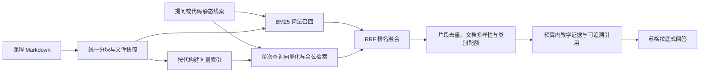

# RAG 优化记录 · 2026-11-03

本次调整把课程文件、词法检索、向量索引与教学上下文连成可验证的同一条链路，重点解决旧块残留、分块过长、向量故障无法恢复、代码查询重复向量化及检索效果缺少基线的问题。

## 1. 现在的检索流程



- `backend/app/core/corpus.py`：讲义、题解、Bug 库、知识点使用同一套分块；记录文档、章节、内容哈希与快照版本。文件路径、大小和纳秒修改时间组成缓存键，新增、删除和普通内容修改会使缓存失效。快照只在所有文件成功读取与解析后发布。
- `backend/app/core/retrieval.py`：中文连续文本按二字组切分，标点两侧不拼词；英文标识符和 `p->next` 一类成员访问单独保留。通过显式标题、章节权重和 BM25 词频评分召回，补充 BST、DFS/BFS、快排等确定性别名。分词与索引统计使用有界缓存。
- `backend/app/core/rag.py`：默认同时召回词法和向量候选，以 RRF 合并排名，不直接混排两种不同量纲的分数。同一查询只计算一次向量，四分类共用。没有可用向量索引或向量发生故障时，仍可使用当前课程文件的词法检索。
- `backend/app/core/rag_index.py`：批量建库、复用未变内容的向量、校验条目数量，通过 manifest 原子切换完整索引代。模型、实际向量后端和预处理约定的签名必须一致才能复用向量。
- `backend/app/agents/socratic.py`：含指代的短追问补充最近的学生提问；代码诊断先提取一次静态线索，再组织短检索查询。代码检索优先保留最多所需的知识点与 Bug 案例配额，避免它们被讲义挤出；配额只有存在相关候选时才生效。

检索结果包含 `chunk_id`、`document_id`、来源文件、章节、知识点编号、检索模式和索引版本；引用对应实际进入模型上下文的片段，讲义和 Bug 库也能追溯。用于旧调用兼容的 `distance` 是融合排名字段，**不再表示余弦距离**；向量原始距离独立保存在 `vector_distance`。

## 2. 分块、上下文和教学内容范围

分块保留标题路径，按标题、段落及代码围栏组织内容。普通大小代码块尽量保持完整；超长块继续拆分，并保持输出代码围栏完整。单块上限为 **350 个估算 token**，教学参考上下文预算为 **1800 个估算 token**，近期对话另有 2000 的估算预算。

这些数值使用本地保守估算：中文和其他非 ASCII 符号逐个计数，英文或标识符约每 3 个字符计一个。它们不是模型厂商的精确 tokenizer，不保证等于模型计费 token，也不代表整条请求的总长度上限；学生本次提交的代码和问题仍需计入实际请求。

默认 `audience="hint"` 排除题解目录和被识别为标准答案、参考实现等答案层级的小节。离线评测可显式用 `audience="all"` 纳入全部内容。这是模型检索上下文的分层策略，不等同于知识库浏览页的权限控制，也不能替代对模型最终回答的检查。

无足够证据时，检索可以返回空列表；提示词要求助教说明证据不足或追问。结构化诊断中的知识点标签限定为本次课程证据中的知识点，减少凭空标签进入学情统计。

## 3. 升级后必须重新建库

**已有旧版 ChromaDB 的部署，需要教师在“知识库”页面执行一次“重新建库”。** 旧版 collection 不带新格式的活动 manifest，不会被当作新向量索引使用。未重建前，词法检索可以继续工作；这不表示向量链路已经就绪。

新索引的活动清单为 `backend/data/vector_db/active-index.json`。每次有实际变化时创建一组新代 collection，只有四类都构建并校验成功后才通过原子文件替换发布 manifest。相同来源版本与模型签名可直接复用已发布代；变更构建中可复用内容哈希相同的旧向量。

- 删除文档或章节后，新代不再包含失效块。
- 即使文件已经变更而向量库尚未重建，检索也会检查当前块 ID 和内容哈希，过滤已删除或已变化的旧片段；未变片段仍可能由上一代召回，变化部分可走词法检索。
- 构建失败时不切换活动 manifest，上一代保持可读；本次暂存代尽力清理。断电或进程终止等异常可能留下暂存数据。
- **旧代不会自动删除。** 多次重建会累积磁盘空间，需在维护窗口确认活动 manifest 后再清理非活动代。不要直接删除活动 collection 或在服务运行时手工改写 manifest。
- 建库锁只覆盖单进程；不同进程同时建库不受支持。部署时指定一个建库 worker，避免多个 Uvicorn worker 同时触发重建。原子 manifest 发布不等同于跨进程构建锁。

## 4. 配置与可恢复降级

| 设置 | 默认值 | 含义 |
| --- | --- | --- |
| `EMBEDDING_MODEL` | `BAAI/bge-small-zh-v1.5` | 本地向量模型；更换模型或实际向量后端后需重新建库 |
| `TOP_K` | `3` | 普通提问默认返回条数；代码诊断单次检索最多选取 6 个候选进入后续预算选择 |
| `RAG_MAX_DISTANCE` | `0.45` | 向量余弦距离上限，越小越保守；需用真实向量评测进一步校准 |
| `RAG_RETRY_SECONDS` | `60` | 向量异常后的重试冷却秒数；到期后下一请求可再次尝试 |
| `KNOWLEDGE_DIR` | `backend/data/knowledge` | 课程文件目录，可用进程环境变量覆盖以隔离测试 |
| `VECTOR_DB_DIR` | `backend/data/vector_db` | 向量数据目录，可用进程环境变量覆盖以隔离测试 |

模型懒加载有线程锁，BGE 查询使用检索指令前缀，文档不加该前缀。模型初始化、向量库访问或查询异常不再使进程永久停留在降级状态。失败信息只记录异常类型，不记录学生查询、代码或第三方异常正文。

- `GET /api/knowledge/retrieval/status`：查看最近检索模式、索引 `missing/stale/ready/error`、索引版本、建库时间、向量后端及剩余冷却时间。
- `POST /api/knowledge/retrieval/reset`：仅教师可调用，解除重试冷却；不下载模型、不重建索引。下一次混合检索才尝试恢复向量链路。
- `POST /api/knowledge/ingest`：沿用教师建库接口；成功建库后也会清除故障冷却。

`last_mode` 是进程最近一次检索的观测，不能当作每个请求的性能或并发指标。未建库、没有通过距离门槛的向量候选时，实际模式会是 `lexical`；请求了 `hybrid` 不代表向量一定参与排序。

## 5. 可复现的离线评测

标注集为 `backend/data/rag_eval.jsonl`，共 32 题：覆盖 20 个知识点、6 个 Bug 查询、2 个别名查询、1 个长查询和 3 个无答案查询。标注是文档级相关性；同一知识点的文件名与 `kp_id` 归并，重复返回同一文档的多个分块不会虚增 Recall。

```bash
cd backend
python -m pytest tests -q
python scripts/check_kp.py --strict
python scripts/eval_rag.py --mode lexical --audience hint --strict --output ../docs/eval/rag-lexical.json
python scripts/eval_rag.py --mode lexical --audience all --strict --output ../docs/eval/rag-lexical-all.json
```

默认评测为 `lexical/hint`，不下载向量模型、不调用大模型。`--strict` 要求 Hit@K 至少 0.75、无答案准确率至少 0.8，且两类样本均存在。CI 使用词法严格评测作为可重复的基础门槛。

三份报告保存了样本集 SHA-256、候选范围、实际返回模式、各题命中与延迟：

| 报告 | 范围与用途 |
| --- | --- |
| [`eval/rag-baseline.json`](eval/rag-baseline.json) | 提交 `e44c02d` 的旧词法算法，全语料 `all` 基线 |
| [`eval/rag-lexical-all.json`](eval/rag-lexical-all.json) | 新词法算法，全语料 `all`，与旧基线公平比较 |
| [`eval/rag-lexical.json`](eval/rag-lexical.json) | 新词法算法，产品默认 `hint` 策略，排除答案类候选 |

同一 32 题、top-3、全语料 `all` 对比：

| 指标 | 旧版词法检索 | 新版词法检索 |
| --- | ---: | ---: |
| Hit@3 | 96.55% | 100% |
| 文档 Recall@3 | 76.44% | 82.18% |
| MRR | 89.66% | 94.25% |
| 返回片段相关率 | 82.76% | 81.61% |
| 无答案准确率 | 33.33% | 100% |
| 查询延迟 p50 | 16.918 ms | 5.349 ms |
| 查询延迟 p95 | 18.427 ms | 6.706 ms |

**返回片段相关率略有下降。** 新实现改善了此样本集上的文档召回与首个相关结果排名，但不能声称所有质量指标都有提升。返回片段相关率只衡量返回内容是否落入标注相关文档，不是模型回答中的引用忠实度。

产品 `hint` 范围的结果为 Hit@3 100%、Recall@3 81.61%、MRR 96.55%、返回片段相关率 82.76%、无答案准确率 100%。它排除了部分答案文档，不能与旧版全语料报告直接作为同范围算法对比；尤其一题的相关标签包含题解文档，`hint` 策略下该目标不可召回。

延迟来自本机串行测试，包含首题冷启动，后续请求受缓存影响；不代表线上硬件、并发或端到端模型响应速度。32 题规模小，只有 3 个无答案问题，也不是独立隐藏测试集，100% Hit 或拒答准确率不构成泛化保证。

## 6. 验证边界与后续工作

本次离线报告验证了词法链路；自动化还以测试替身覆盖索引发布、失败保留、更新过滤、查询向量复用、融合及降级恢复等行为。**尚未用真实本地向量模型完成混合检索质量评测，也未验证真实大模型的回答质量。** 0.45 距离门槛是可配置的初始值，不能视为已校准的相关性概率。

下一阶段应补充教师标注的真实学生追问、长代码、跨知识点问题和困难负例；在相同样本及候选范围上比较真实 lexical/hybrid，再评估 reranker 的质量增益、延迟与部署成本。reranker 尚未引入，不应仅为增加模型层数而上线。

## 7. 最终验证

- 后端 54 项测试通过（包含真实临时 Chroma 数据库的索引事务测试，向量采用测试替身，不下载模型）。
- 前端 9 项单元测试、10 项 Chromium 浏览器回归通过；新增讲义引用直达来源章节的验证。
- 20 个知识点严格校验、32 题离线词法严格评测、前端生产构建通过。
- 活动清单损坏时，查询降级为词法，教师重新建库可创建新代恢复。
