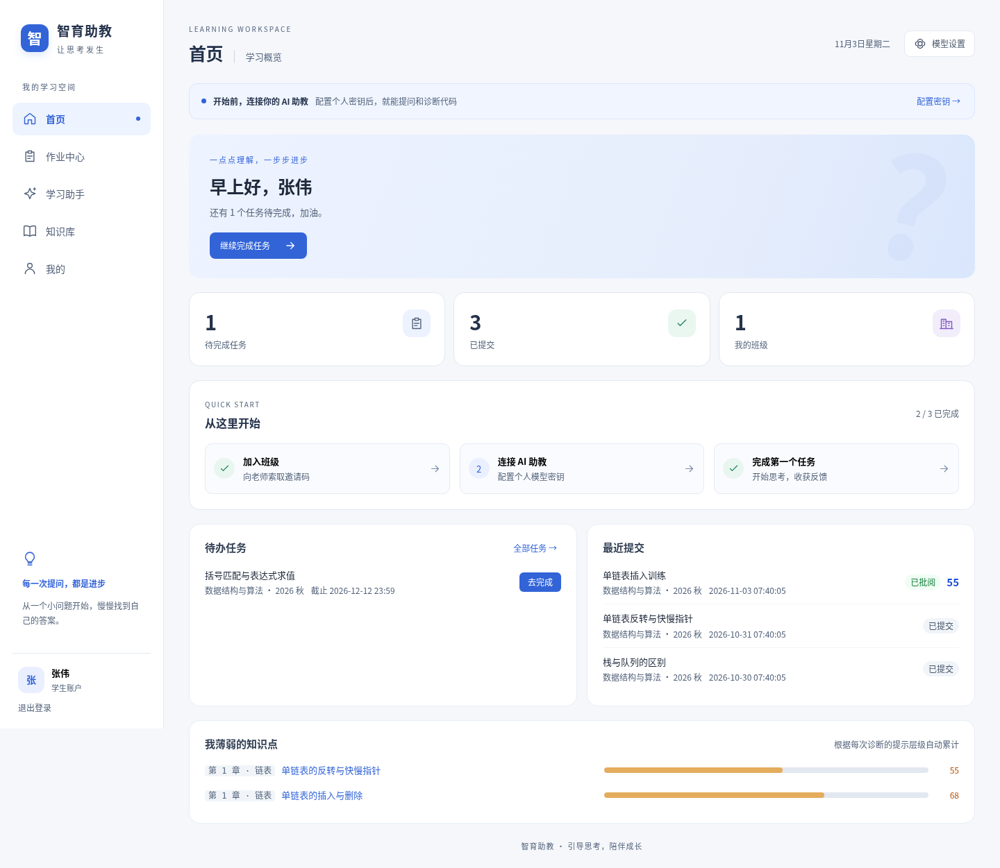
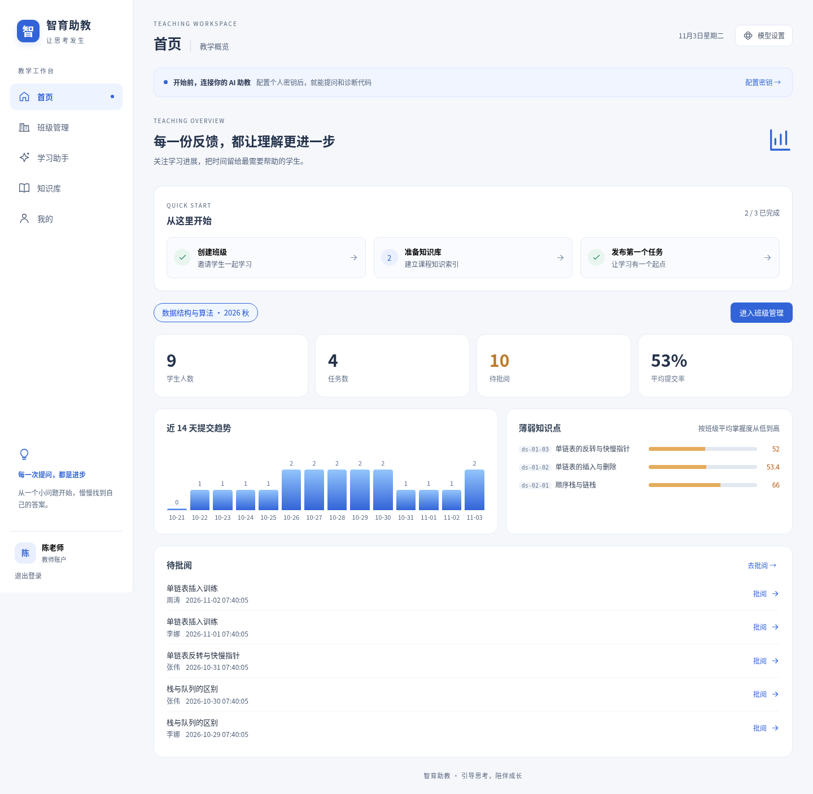

# UI 与体验优化 · 2026-11-03

本次覆盖先前提出的 14 项优化，沿用蓝色主色，统一桌面与移动端的学习、教学工作台。截图来自 Chromium 实际运行的页面，使用独立临时数据库中的演示账号，无真实密钥，无真实模型请求。

## 改动对应表

| 优化项 | 已落地行为 |
| --- | --- |
| 移动导航 | 760px 以下改为固定底部导航，顶部保留模型设置，适配安全区域 |
| 页面状态 | 主页面和助手模式使用 KeepAlive；保留聊天、代码、问答草稿及班级、任务和筛选选择；退出账户时销毁缓存 |
| 生成反馈 | 聊天与代码诊断支持等待反馈、取消请求、失败提示和重试；异常时恢复按钮 |
| 作业状态 | 区分待提交、待重做、待批阅和已批阅；退回任务进入待办并优先排序，随后按截止时间排序 |
| 任务直达 | 学生首页定位问答任务；教师首页定位班级、任务、待批阅列表和指定提交 |
| 异步状态 | 共用骨架屏、失败重试和空状态；列表读取失败不再伪装为空数据，切班与详情请求防止旧响应覆盖新选择 |
| 视觉规范 | 共用颜色、圆角、边框、按钮、卡片、焦点样式，重做登录页及首页 |
| 可读性 | 调整辅助字号、文字对比度、长标题换行，增加输入与控件标签 |
| 顶部信息 | 简化正常状态提示，技术信息折叠为按需查看；未配置密钥提供明确入口 |
| 聊天阅读 | 仅在接近底部时跟随新消息，否则显示“有新内容”；参考知识点可打开并展开对应正文 |
| 首次引导 | 按身份显示三步操作引导；手机端省略已完成步骤，减少占用 |
| 键盘操作 | 登录密码显隐、中文输入法 Enter 防误发、弹窗焦点限制与恢复、Esc 关闭、列表键盘访问和 reduced-motion 支持 |
| 加载性能 | 主页面、助手模式、编辑器按需加载；只注册 C/C++ 和纯文本语法高亮，编辑器独立分块 |
| 图表与图标 | 用统一 SVG 图标替换主导航 Emoji；趋势图展示每日数值，支持鼠标、键盘及触屏选中 |

## 截图

| 页面 | 预览 |
| --- | --- |
| 登录 | [登录页](screenshots/login.png) |
| 学生首页 | [桌面首页](screenshots/student-home.png) |
| 教师首页 | [教学概览](screenshots/teacher-home.png) |
| 学习助手 | [对话提问](screenshots/assistant.png) |
| 代码诊断 | [代码编辑器](screenshots/code-diagnosis.png) |
| 作业中心 | [任务与提交](screenshots/homework.png) |
| 知识库 | [分类与搜索](screenshots/knowledge.png) |
| 手机 | [390 × 844 首页](screenshots/student-mobile.png) |





## 验证与复现

后端原有 18 项测试通过。前端包含原有 7 项 SSE 回归及新增 2 项作业状态与排序测试。新增 9 项 Playwright 浏览器回归，覆盖真实登录、草稿保留、延迟加载、退回重做、任务与批阅直达、手机布局、弹窗键盘交互、网络失败重试、引用跳转、输入法确认、停止生成、加载失败恢复及登录过期后的身份切换。

```bash
cd frontend
npm ci
npm test
npm run build
npx playwright install chromium
```

浏览器测试会注册临时测试账号并创建班级、任务和提交，必须对独立测试数据库运行，不能指向生产环境。另开终端启动：

```bash
cd backend
# Windows PowerShell 请用 $env:APP_DB_PATH 设置绝对路径
APP_DB_PATH=/tmp/zhiyu-ui-regression.db python -m uvicorn app.main:app --port 8000
```

随后执行：

```bash
cd frontend
npm run test:e2e
# 自备 Chromium 时可设置 PLAYWRIGHT_CHROMIUM_EXECUTABLE
# 其他本地端口可设置 E2E_BASE_URL
```

GitHub Actions 已加入 Chromium 回归，失败时上传 trace，保留 7 天。

## 性能与边界

原构建的主 JS 约 1,715 KB（gzip 561 KB），现入口约 104 KB（gzip 41 KB），入口压缩体积下降约 93%。这是入口脚本的比较，其他页面会继续按需加载，不能等同于所有页面总下载量。

代码编辑器拆为约 157 KB 与 363 KB 的依赖块，仅在进入代码诊断时加载，构建不再触发 500 KB 大包提示。

草稿仅在当前应用会话中保留；刷新浏览器、关闭窗口和退出登录不保证恢复，正文不额外写入本地持久化存储。停止按钮取消浏览器请求，不承诺模型供应商已停止计费；重试仍走现有后端接口，可能增加一条历史记录。浏览器回归中的模型响应采用测试替身，没有验证真实模型连通性或教学回答质量。

## 最终检查结果

- 18 项后端测试、9 项前端单元测试、9 项浏览器回归全部通过；生产构建通过。
- 390px 下五个主页面的文档宽度均为 390px，无横向溢出。
- 截图流程覆盖登录、学生首页、作业、知识库、对话、代码编辑器、手机首页和教师首页，未记录到浏览器运行时异常。
- 学习助手页通过本次 axe WCAG A/AA 自动检查，零违规；这不代表完整的人工无障碍审计。
- 补充处理登录过期后身份切换的页签清理，以及 KeepAlive 页面离开时弹窗焦点与滚动锁的释放。
